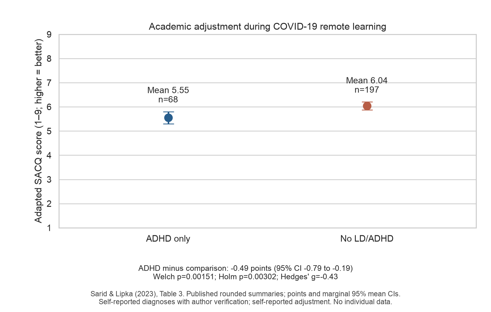
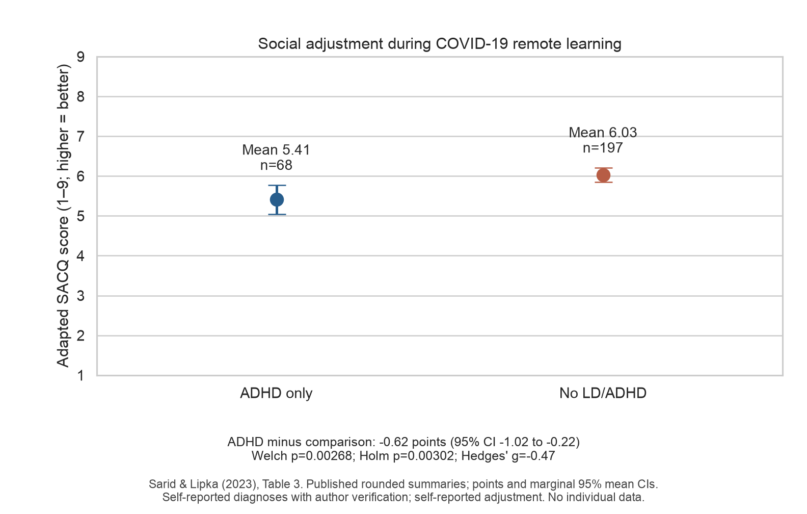

# ADHD, academic outcomes, and social adjustment

Reproducible statistical analysis of academic and social adjustment among university students with ADHD, with a separate audit of continuous ADHD symptom scores. The findings inform discussion of support in Kazakhstan; they do not estimate a Kazakhstan-specific effect or establish causation.

**Start with the [current results report](adhd_statistical_analysis/outputs/ADHD_results_report.md).** It contains methods, confidence intervals, effect sizes, missing-data and scoring audits, contrary findings, and an IMRaD Results paragraph. See the [source manifest](adhd_statistical_analysis/outputs/source_manifest.md), [bibliography](references.bib), and [data attribution](DATA_LICENSE.md) for provenance and citations.

## Primary results

The primary analysis uses **published rounded summary statistics**, not participant-level Israeli observations. Sarid & Lipka (2023), Table 3, compares ADHD-only students (n=68) with students without LD/ADHD (n=197) during COVID-19 remote learning in Israel. Diagnoses were self-reported with the verification procedures described by the authors. Academic and social adjustment are distinct self-reported adapted SACQ subscales, with higher scores indicating better adjustment. Neither outcome is objective GPA. [Source](https://doi.org/10.3389/fpsyg.2023.1172771).

| Outcome | ADHD minus comparison [95% CI] | Hedges' g | Two-sided Welch p | Holm p |
| --- | --- | --- | --- | --- |
| Academic adjustment | −0.49 [−0.789, −0.191] | −0.429 | .001512 | .003025 |
| Social adjustment | −0.62 [−1.020, −0.220] | −0.470 | .002682 | .003025 |

Both differences meet the Holm-corrected .05 threshold across these two primary tests. Confidence intervals are marginal 95% intervals. Values are approximate because the source summaries are rounded. No synthetic participant observations or unavailable distribution statistics are generated.





## South African data and limitations

The local workbook is byte-identical to Rousseau et al.'s (2024) openly published [UCT/Figshare dataset](https://doi.org/10.25375/uct.24906924.v1), licensed CC BY 4.0. ASRS subscales follow the explicit item mapping in [Mohamad et al. (2025)](https://doi.org/10.1177/10870547241310659). ASRS symptom severity is not treated as a diagnosis.

- Inattention and the stored baseline AAS score reproduce r=−0.204748, N=488, p≈5.12×10⁻⁶. Total ASRS symptoms instead give r=−0.138592, which rounds to the earlier −0.14 claim. The historical Holm p=.015 remains unverified.
- Eighteen AAS records contain partial-item totals. Only complete nine-item records enter the provisional score audits. The released AAS reverse-coding history is unresolved, so these calculations do not establish a validated academic-adjustment result.
- The paper's weighted GPA is absent from the release. `psy1004_grade` is not relabeled as GPA; the requested GPA regression remains unavailable. Repeated wave-2/3 item data and participant IDs are also absent.
- Hyperactivity/impulsivity associations and the ASRS coefficient after BDI-II adjustment are non-significant. Published matched-cohort findings also qualify any general claim of uniform academic or social deficits. [Baczewski et al. (2022)](https://doi.org/10.1089/aut.2021.0012).

Self-report, nonrepresentative samples, COVID context, multiple comparisons, selection/attrition, measurement uncertainty, and confounding limit interpretation. Findings are associative and cannot be transferred directly to Kazakhstan. A limited search identified no comparable accessible Kazakhstan ADHD participant-level dataset.

## Reproduce the current analysis

Python 3.11+ is required; the recorded run used Python 3.12. From the repository root:

```bash
cd adhd_statistical_analysis
python3.12 -m venv .venv
source .venv/bin/activate
python -m pip install -r requirements-lock.txt
python run_analysis.py
python -m pytest -q
python verify_outputs.py
```

The public workbook, published summary inputs, and attributed Table 3 fixture are included, so the analysis and tests work offline after dependency installation. `python fetch_sources.py` optionally retrieves source pages and validates the public workbook checksum. Full publisher-page caches are not redistributed in this update. See the [project README](adhd_statistical_analysis/README.md) for alternative `uv` commands, outputs, and the raw-data fallback.

The pipeline uses seed 42, two-sided α=.05, separate prespecified multiplicity families, Welch tests for the primary comparisons, Pearson/Spearman score audits, and exploratory HC3 regression diagnostics. **17 numerical/provenance checks pass**, including independent SciPy/statsmodels comparisons and successful primary analysis when raw South African data are unavailable. [Validation record](adhd_statistical_analysis/outputs/validation_summary.md).

## Sources and citation

The dataset and original studies must be credited independently of this secondary analysis. Full citations appear in [references.bib](references.bib), the report, and the source manifest. GitHub's **Cite this repository** button uses [CITATION.cff](CITATION.cff).

1. Rousseau, K., Mohamad, N., Dowlut, F., Gering, M., & Thomas, K. (2024). *ADHD and Common Mental Disorders: Effect on Academic Success in SA First-Years* [Dataset, v1]. [10.25375/uct.24906924.v1](https://doi.org/10.25375/uct.24906924.v1).
2. Mohamad, N., Rousseau, K.-L., Dowlut, F., Gering, M., & Thomas, K. G. F. (2025). *Symptoms of ADHD and Other Common Mental Disorders Influence Academic Success in South African Undergraduates*. [10.1177/10870547241310659](https://doi.org/10.1177/10870547241310659).
3. Sarid, M., & Lipka, O. (2023). *Students with learning disabilities/attention-deficit/hyperactivity disorder in higher education dealing with remote learning: lessons learned from COVID-19 era*. [10.3389/fpsyg.2023.1172771](https://doi.org/10.3389/fpsyg.2023.1172771).
4. Gormley, M. J., DuPaul, G. J., Weyandt, L. L., & Anastopoulos, A. D. (2019 issue; online 2016). *First-Year GPA and Academic Service Use Among College Students With and Without ADHD*. [10.1177/1087054715623046](https://doi.org/10.1177/1087054715623046).
5. Lipka, O., Sarid, M., Aharoni Zorach, I., Bufman, A., Hagag, A. A., & Peretz, H. (2020). *Adjustment to Higher Education: A Comparison of Students With and Without Disabilities*. [10.3389/fpsyg.2020.00923](https://doi.org/10.3389/fpsyg.2020.00923).
6. Baczewski, L. M., Pizzano, M., Kasari, C., & Sturm, A. (2022). *Adjustment Across the First College Year: A Matched Comparison of Autistic, Attention-Deficit/Hyperactivity Disorder, and Neurotypical Students*. [10.1089/aut.2021.0012](https://doi.org/10.1089/aut.2021.0012).
7. Anderson, J. R., Guan, Y., & Koc, Y. (2016). *The academic adjustment scale: Measuring the adjustment of permanent resident or sojourner students*. [10.1016/j.ijintrel.2016.07.006](https://doi.org/10.1016/j.ijintrel.2016.07.006). [Author's scale appendix](https://www.researchgate.net/publication/305617123_The_AAS_-_appendix).
8. Yertukeshova, G., et al. (2024). *Assessment of the Relationship between Mental Health and Academic Achievement among Students in Kazakhstan*. [10.52965/001c.125270](https://doi.org/10.52965/001c.125270). Context only; no ADHD exposure.

## Earlier repository materials

The earlier notebooks, interactive graphs, presentation files, and root-level analysis files remain available for historical reference. Their original entry point is preserved in [docs/legacy_README.md](docs/legacy_README.md). For the current two-question conclusions, source qualifications, and multiplicity corrections, use the report and pipeline under `adhd_statistical_analysis/`.
