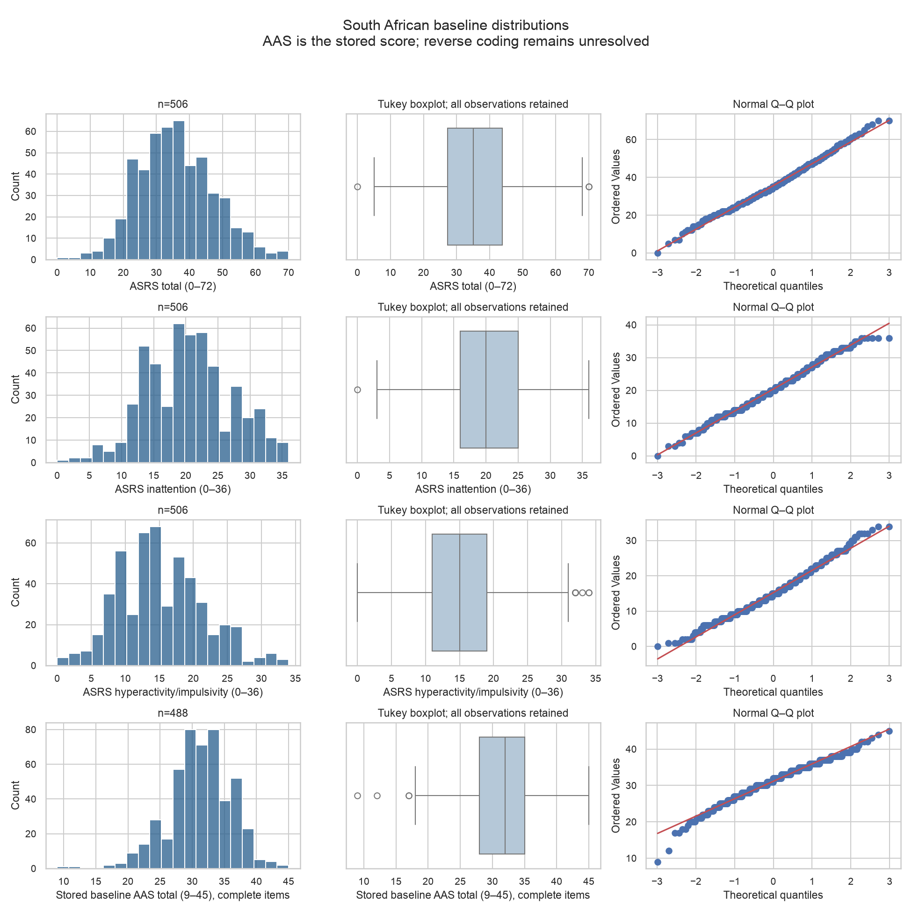
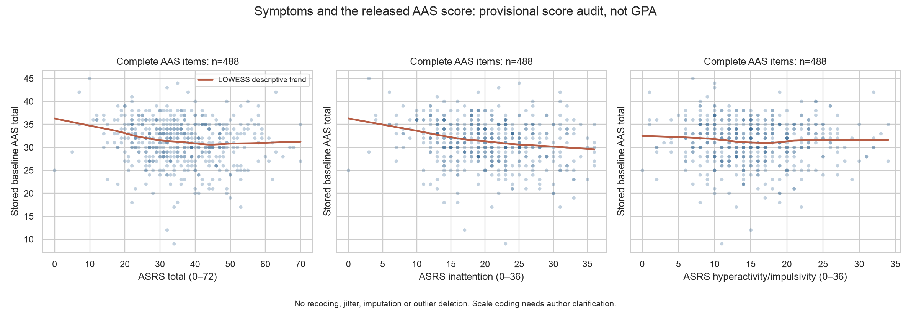

# ADHD, academic outcomes and social adjustment

Analysis date / source access: 20 October 2026. Two-sided α=.05. Reproducible secondary analysis; conclusions concern associations and differences, not causation.

## Research questions and answers

1. **Academic:** Is ADHD associated with poorer academic outcomes, and is higher symptom severity associated with poorer GPA or adjustment? The primary Israeli comparison supports lower **self-reported academic adjustment** in the ADHD-only group. This is not a GPA test. Published US GPA findings provide separate corroborating context; the South African released workbook does not permit the requested verified GPA reanalysis.
2. **Social:** Is ADHD associated with lower social adjustment? The Israeli comparison supports lower **self-reported social adjustment** during remote learning. It does not directly measure observed social ability, all social-functioning domains, or outcomes in Kazakhstan.

## Primary hypotheses, populations and methods

For each outcome H₀ is μ_ADHD−μ_comparison=0. The research prediction is a negative difference, assessed with two-sided tests. The two outcomes form one prespecified primary family with Holm correction. `analysis_plan.md` was written after source QA and before this pipeline's inferential calculations; the task already contained validation p-value expectations, so this is not an independent preregistration.

We transcribed only Table 3 columns **C (ADHD-only)** and **A (no LD/ADHD)** in Sarid & Lipka (2023): n=68 and n=197. LD-only and LD+ADHD groups are excluded from this focused contrast. Participants were Hebrew-speaking undergraduates from Israeli higher-education institutions during spring 2020 COVID-19 remote learning. Diagnoses were self-reported; the authors describe requesting recent diagnostic certification and phone confirmation, with the COVID sample undergoing the same verification procedure. This does not constitute a new clinical diagnostic assessment by this project. [Methods and Table 3](https://www.frontiersin.org/journals/psychology/articles/10.3389/fpsyg.2023.1172771/full).

The adapted Hebrew SACQ uses 1–9 responses with higher scores indicating better adjustment. The remote-learning version has 22 academic items and 7 social items; it is abbreviated and context adapted. Academic adjustment and social adjustment are distinct self-reported constructs. No GPA is used in either primary test. Welch's method uses sample SDs and Satterthwaite degrees of freedom, accommodates unequal variances and does not require an equal-variance pretest. It assumes independent participant groups and approximately valid inference for their mean differences. With n=68/197 a mean comparison is reasonable, but distributions and influential observations cannot be checked from aggregates. Group comparability is limited: these are unadjusted, nonrandomized groups with potential differences in year of study, support and comorbidity.

For group i, vᵢ=sᵢ²/nᵢ; SE(Δ)=√(v₁+v₀); t=Δ/SE; ν=(v₁+v₀)²/[v₁²/(n₁−1)+v₀²/(n₀−1)]. The 95% CI is Δ±t₀.₉₇₅,νSE. Signed Hedges' g is J×Δ/s_pooled, using the pooled sample SD and exact gamma-ratio small-sample correction J with n₁+n₀−2 degrees of freedom. Under unequal variances g is a descriptive standardized contrast; inference for Δ remains Welch-based. The CSV also labels approximate pooled-SD Wald intervals for g separately. All reported 95% intervals are **marginal, not simultaneous family-wise intervals**. Holm-adjusted p-values determine the two primary decisions.

## Primary results: published-summary reanalysis

| Outcome | ADHD-only mean (sample SD) | No LD/ADHD mean (sample SD) |
| --- | --- | --- |
| academic adjustment | 5.55 (1.04) | 6.04 (1.17) |
| social adjustment | 5.41 (1.49) | 6.03 (1.25) |

| Hypothesis / outcome | ADHD-only; comparison | Difference [95% CI] | Welch t (df) | Raw p | Holm p | Hedges' g | Decision |
| --- | --- | --- | --- | --- | --- | --- | --- |
| academic adjustment | n=68; n=197 | -0.49 [-0.789, -0.191] | -3.241 (129.855) | 0.00151226 | 0.00302451 | -0.429 | Supported in this sample |
| social adjustment | n=68; n=197 | -0.62 [-1.020, -0.220] | -3.078 (101.461) | 0.00268214 | 0.00302451 | -0.470 | Supported in this sample |

Negative differences and g indicate worse reported adjustment in ADHD-only students. Both hypotheses are supported for these measured outcomes in this sampled context after Holm correction. Values are approximate because the source means/SDs were rounded. The authors' four-group ANOVA and Tukey comparisons use different estimands, error estimates and multiplicity families; their reported F statistics are not this focused Welch reanalysis.

Only N, mean and sample SD are observed summaries. Group mean CIs, differences, Welch tests and standardized contrasts are valid derived quantities. **Medians, quartiles, IQR, observed ranges, skewness, outliers, Shapiro tests, Brown–Forsythe/Levene tests and participant-level Mann–Whitney or permutation tests are not computable from summary statistics.** Missing N/% is not reported for these specific table cells and cannot be inferred from the groups' stated sample sizes. No individual observations are simulated.

### Participant-level academic data: South Africa

The public workbook contains 506 baseline rows and 110 named columns in `Sheet1`, with no participant IDs and no repeated wave-2/3 item fields. ASRS totals match the documented 18-item sum in all 506 rows. Inattention uses items 1–4 and 7–11; hyperactivity/impulsivity uses 5–6 and 12–18. Both subscales range 0–36 and total symptoms range 0–72. These continuous questionnaire scores do not establish ADHD diagnoses. The source paper reports that missing ASRS/BAI values were imputed before its analyses; the release does not identify imputed cells. We make no additional imputations. [Methods](https://pmc.ncbi.nlm.nih.gov/articles/PMC11800717/).

| Variable | N / missing | Mean (sample SD) | Median [Q1, Q3] | IQR | Min–max | Skewness | 95% mean CI |
| --- | --- | --- | --- | --- | --- | --- | --- |
| asrs_total | 506 / 0 | 35.67 (11.51) | 35.00 [27.25, 43.75] | 16.50 | 0–70 | 0.232 | [34.66, 36.68] |
| inattention | 506 / 0 | 20.42 (6.69) | 20.00 [16.00, 25.00] | 9.00 | 0–36 | 0.066 | [19.83, 21.00] |
| hyperactivity | 506 / 0 | 15.25 (6.29) | 15.00 [11.00, 19.00] | 8.00 | 0–34 | 0.375 | [14.70, 15.80] |
| aas_complete | 488 / 18 | 31.15 (4.83) | 32.00 [28.00, 35.00] | 7.00 | 9–45 | -0.534 | [30.72, 31.58] |

All raw-data missing percentages, quartiles, skewness and mean CIs are in `descriptive_statistics.csv`. The complete-item AAS outcome has 18/506 missing (3.56%). The stored AAS total has no missing entries because 18 partial-item records were summed over their observed items; these totals are set missing only in the prepared analysis variable.

**Scoring limitation:** the original AAS author appendix marks items 2 and 3 for reverse scoring. The stored workbook total is exactly the direct sum of the nine stored items. The workbook has no item wording, randomization/order information, or recoding history to establish whether those stored items have already been reversed. Item correlations raise a scoring concern but cannot resolve it. We therefore retain the author-supplied complete-item composite without guessing a recoding and treat the following calculations as a provisional numerical audit, **not verified evidence about a correctly scored academic-adjustment construct**. The paper specifies the intended total direction as higher = better. Nine items scored 1–5 imply 9–45; the paper's stated minimum of 1 is arithmetically inconsistent. [Original scale appendix](https://www.researchgate.net/publication/305617123_The_AAS_-_appendix); [study methods](https://pmc.ncbi.nlm.nih.gov/articles/PMC11800717/).

| Symptom score | N | Pearson r [95% CI] | Raw p | Holm p | Spearman rho [bootstrap 95% CI] | Spearman raw / Holm p |
| --- | --- | --- | --- | --- | --- | --- |
| asrs_total | 488 | -0.139 [-0.225, -0.050] | 0.00215085 | 0.00430171 | -0.153 [-0.239, -0.062] | 0.000695226 / 0.00139045 |
| inattention | 488 | -0.205 [-0.288, -0.118] | 5.11954e-06 | 1.53586e-05 | -0.212 [-0.299, -0.120] | 2.23827e-06 / 6.71481e-06 |
| hyperactivity | 488 | -0.035 [-0.123, 0.054] | 0.440325 | 0.440325 | -0.047 [-0.134, 0.044] | 0.295112 / 0.295112 |

Pearson tests use a two-sided t-equivalent test (df=N−2) and Fisher-z CIs. Spearman uses asymptotic two-sided p-values and 5,000 paired percentile bootstrap resamples with seed 42 for CIs. Each three-test family receives its own Holm correction. The plots show bounded/discrete scores and a mild trend; rank analysis checks sensitivity to tails and nonlinearity. Shapiro statistics and Tukey outlier counts are in `distribution_diagnostics.csv`, used descriptively, with no automatic test switching or deletion. No diagnosed raw-data groups exist, so Brown–Forsythe/Levene and group Mann–Whitney tests are not appropriate here.

### Reconciliation of earlier coefficients

Using the documented inattention items and complete AAS responses gives **r=-0.204748, N=488, raw p=5.11954e-06**, with this audit family's Holm p=1.53586e-05. This independently checks the historical r=−0.205, N=488, p=5.12×10⁻⁶ claim. The correctly defined result is determined by the scoring rule, not by its p-value.

The documented **ASRS total**, rather than inattention alone, gives r=-0.138592, N=488, raw p=0.00215085; this rounds to **−0.14**. Thus the two reported coefficients can be numerically reconciled as **different symptom exposures on the same baseline outcome/sample**. Attribution of that earlier slide to ASRS total remains an inference because its code is absent. This audit's three-test Holm p for ASRS total is 0.00430171, not .015. The old .015 cannot be established without that version's sample and correction family and remains **unresolved**; no past adjusted p-value is reused. As a separate scoring-error check fixed in the analysis specification, a rejected sum of the first nine ASRS items gives r=-0.166691, which matches neither claimed coefficient and mixes symptom clusters. No presentations or prior analysis script containing those results were present. The earlier notebook only imports and reads the workbook.

### Conditional regression audit and unavailable GPA analysis

| Exploratory score model | N | ASRS coefficient [HC3 95% CI] | t (df) | Raw / Holm p | R² |
| --- | --- | --- | --- | --- | --- |
| AAS_base | 488 | -0.0563 [-0.0957, -0.0169] | -2.810 (483) | 0.0051584 / 0.0103168 | 0.040 |
| AAS_plus_BDI | 488 | -0.0095 [-0.0503, 0.0312] | -0.460 (482) | 0.645893 / 0.645893 | 0.077 |

The base model conditions on age, Grade 12 score and the released `nbt_ave`; the second model adds BDI-II. Coefficients express stored AAS points per one ASRS point. Holm correction covers the two ASRS coefficients. HC3 standard errors allow heteroskedasticity; they do not fix measurement error, omitted variables or unresolved AAS scoring. Maximum VIF across these models is 1.39. Cook's-distance flags above 4/N: 24 in the base model and 26 in the BDI sensitivity model; these thresholds are diagnostic and no records are removed. See coefficient, VIF and residual-diagnostic files for details. A changed coefficient after BDI adjustment may reflect shared variance or overadjustment; it is not a mediation or causal result.

The hyperactivity/impulsivity correlation is non-significant in both Pearson and rank audits. The ASRS coefficient is also non-significant after BDI-II adjustment, with its CI spanning zero. These null findings are retained alongside negative associations; none supports a uniform symptom effect across measures or specifications.

**Objective GPA:** the paper's weighted first-semester GPA is not present in the public workbook. The field `psy1004_grade` has mean 60.52, SD 11.20 and range 28–88; the paper's GPA has mean 63.54, SD 11.41 and range 1.50–88.34 (Table 3). It cannot be relabeled as GPA. Consequently ASRS–GPA correlations, adjusted GPA regression and direct raw-data verification of the paper's GPA findings are **pending verified GPA data and a mapping/codebook**. `b1`/`b2` are absent and receive no guessed meaning.

**Repeated measures and attrition:** the article reports 506 → 332 → 180 participants (34.4% attrition by wave 2; 64.4% by wave 3 relative to baseline). The release contains 176 nonmissing `aas_change` values, not 180, and no wave-2/3 AAS items or IDs. The exact slope construction cannot be verified; the field is described but excluded from inference. The source's longitudinal results are not reproduced by treating rows or slopes as independent repeated observations. The auxiliary `Outliers` sheet contains 10 headerless records and broken external `#REF!` formulas; it is not appended to the canonical 506-row cohort. Upstream selection and completeness may bias associations. The article also reports lower GPA among non-completers, so attrition cannot be assumed irrelevant.

## Triangulation, contrary results and objective grades

**Gormley et al. (2019 issue; online 2016)** report a rigorously classified US ADHD sample, distinct from ASRS symptom severity or self-reported diagnosis alone. Table 1 gives n=133 ADHD and n=145 comparison participants for the GPA-differences analysis. Table 2 reports fall GPA 2.91 (SD .77) versus 3.26 (.69) and spring GPA 2.79 (.84) versus 3.13 (.82). Their medication-adjusted follow-up ANCOVAs report fall p=.002 and spring p=.013. These are **published contextual findings, not newly calculated tests**. The published Table 2 t entries do not straightforwardly match a simple reconstruction from the listed GPA-analysis Ns and rounded summaries, so no additional Welch tests are presented here. Fall/spring values come from the same students and cannot be pooled as independent samples. Registrar records were used where possible and participants were contacted when records were incomplete. [Tables 1–2 and methods](https://pmc.ncbi.nlm.nih.gov/articles/PMC6209537/).

**Lipka et al. (2020)** Table 3 has a **combined ADHD/LD** column (n=67), with academic adjustment 5.76 (1.03) versus control 6.40 (1.12), and social adjustment 6.16 (1.26) versus 6.47 (1.14). This is mixed-population context and cannot establish an ADHD-only effect. Its table reports different overall disability/control counts from the abstract, another reason not to treat its mixed summaries as interchangeable primary data. The 2023 article draws its pre-pandemic comparison from the earlier study; these sources are not all independent evidence. [Table 3](https://www.frontiersin.org/journals/psychology/articles/10.3389/fpsyg.2020.00923/full).

**Baczewski et al. (2022)** matched 74 autistic, 74 ADHD and 74 neurotypical US freshmen on baseline characteristics, including mental health/demographic factors. With its Bonferroni α=.008, several adjusted three-group outcomes were not significantly different: intellectual self-confidence (p=.32), psychological stress (p=.02, not significant at its adjusted threshold), sense of belonging (p=.22), campus satisfaction (p=.10), and balancing academic/social demands (p=.10). Social self-confidence differences primarily involved autistic versus the other groups, not an established universal ADHD social deficit. The full text also reports an academic-success omnibus p=.003 and an autism-versus-ADHD contrast p=.002, so it should not be summarized as finding no differences whatsoever. These are the authors' analyses, not our retests; non-significance is not equivalence. Only students completing start/end surveys were included. [Full-text results](https://pmc.ncbi.nlm.nih.gov/articles/PMC8992914/).

Kim et al. (2015) was not added to the testing families because its high-risk questionnaire groups are schoolchildren, not diagnosed university students. No datasets were selected for producing small p-values.

## Kazakhstan applicability and limitations

A targeted public search on 2026-10-20 for Kazakhstan university ADHD/GPA data and Figshare/Mendeley records found **no accessible, comparable participant-level dataset** containing verified ADHD status or ASRS severity together with the required academic/social outcomes and usable documentation. This is a limited search result, not proof that none exists. A relevant Kazakhstan study of 576 students assessed GHQ-12 mental health and achievement motivation, without ADHD measures; its published availability statement does not supply a usable ADHD participant-level dataset. It is excluded from the tests. Search queries and screened links are recorded in `source_manifest.md`. [Kazakhstan contextual study](https://pmc.ncbi.nlm.nih.gov/articles/PMC11820214/).

The primary evidence uses self-reported adjustment and self-reported diagnoses with author-described verification, a nonrepresentative sample, and an exceptional COVID-19 learning context. Summary data prevent distribution, missingness and individual-confounding checks. Multiple testing is handled within defined families; exploratory score audits remain exploratory. The South African release has measurement and field-mapping uncertainties, author-side imputation, selection and substantial longitudinal attrition. Matching and adjustment in other studies do not eliminate confounding or demonstrate causation. Negative effects are not uniform across all adjustment domains or samples, and non-significant findings deserve equal reporting. Neither effect sizes nor prevalence estimates can be transported directly to Kazakhstan. These findings motivate locally evaluated support and prospective measurement, but do not estimate a Kazakhstan-specific effect or the effectiveness of an intervention.

## IMRaD Results paragraph

In a secondary analysis of published rounded summaries from Israeli undergraduates studying remotely during spring 2020, the ADHD-only group (n=68) reported lower academic adjustment than students without LD/ADHD (n=197; 5.55±1.04 vs 6.04±1.17; mean difference=-0.49, 95% CI [-0.789, -0.191]; Welch t(129.86)=-3.241, two-sided p=0.00151226, Holm-adjusted p=0.00302451, Hedges' g=-0.429). Social adjustment was also lower (5.41±1.49 vs 6.03±1.25; difference=-0.62, 95% CI [-1.020, -0.220]; t(101.46)=-3.078, p=0.00268214, Holm-adjusted p=0.00302451, g=-0.470). Both comparisons met the corrected α=.05 criterion. These outcomes were self-reported adjustment, not objective GPA or observed social ability. The South African release supported a provisional symptom-score audit but lacked verified GPA and sufficient AAS scoring documentation for a definitive participant-level academic-outcome conclusion.

## Reproducibility and references

Run `python run_analysis.py` from the project directory after installing `requirements.txt`; `README.md` gives full commands. All numerical tables and plots are generated by code. `analysis_plan.md`, `cleaning_log.md`, `data_validation.json`, `historical_reconciliation.json` and `run_metadata.json` document choices and limitations. The two primary Welch results are independently checked against SciPy and unit-tested, and Holm is checked against statsmodels. Dependencies used in this run are recorded in `requirements-lock.txt` and `run_metadata.json`.

1. Rousseau, K., Mohamad, N., Dowlut, F., Gering, M., & Thomas, K. (2024). *ADHD and Common Mental Disorders: Effect on Academic Success in SA First-Years* [Data set, v1]. University of Cape Town / Figshare. [DOI: 10.25375/uct.24906924.v1](https://doi.org/10.25375/uct.24906924.v1). CC BY 4.0. [Metadata](https://api.figshare.com/v2/articles/24906924), [workbook](https://ndownloader.figshare.com/files/43834113).
2. Mohamad, N., Rousseau, K.-L., Dowlut, F., Gering, M., & Thomas, K. G. F. (2025). *Symptoms of ADHD and Other Common Mental Disorders Influence Academic Success in South African Undergraduates*. Journal of Attention Disorders, 29(5), 363–386. [DOI: 10.1177/10870547241310659](https://doi.org/10.1177/10870547241310659). [Full text](https://pmc.ncbi.nlm.nih.gov/articles/PMC11800717/).
3. Sarid, M., & Lipka, O. (2023). *Students with learning disabilities/attention-deficit/hyperactivity disorder in higher education dealing with remote learning: lessons learned from COVID-19 era*. Frontiers in Psychology, 14, 1172771. [DOI / full text](https://www.frontiersin.org/journals/psychology/articles/10.3389/fpsyg.2023.1172771/full).
4. Gormley, M. J., DuPaul, G. J., Weyandt, L. L., & Anastopoulos, A. D. (2019 issue; online 2016). *First-Year GPA and Academic Service Use Among College Students With and Without ADHD*. Journal of Attention Disorders, 23(14), 1766–1779. [DOI: 10.1177/1087054715623046](https://doi.org/10.1177/1087054715623046). [Full text](https://pmc.ncbi.nlm.nih.gov/articles/PMC6209537/).
5. Lipka, O., Sarid, M., Aharoni Zorach, I., Bufman, A., Hagag, A. A., & Peretz, H. (2020). *Adjustment to Higher Education: A Comparison of Students With and Without Disabilities*. Frontiers in Psychology, 11, 923. [DOI / full text](https://www.frontiersin.org/journals/psychology/articles/10.3389/fpsyg.2020.00923/full).
6. Baczewski, L. M., Pizzano, M., Kasari, C., & Sturm, A. (2022). *Adjustment Across the First College Year: A Matched Comparison of Autistic, Attention-Deficit/Hyperactivity Disorder, and Neurotypical Students*. Autism in Adulthood, 4(1), 12–21. [DOI: 10.1089/aut.2021.0012](https://doi.org/10.1089/aut.2021.0012). [Full text](https://pmc.ncbi.nlm.nih.gov/articles/PMC8992914/).
7. Anderson, J. R., Guan, Y., & Koc, Y. (2016). *The academic adjustment scale: Measuring the adjustment of permanent resident or sojourner students*. International Journal of Intercultural Relations, 54, 68–76. [DOI: 10.1016/j.ijintrel.2016.07.006](https://doi.org/10.1016/j.ijintrel.2016.07.006). [Author-uploaded scale appendix](https://www.researchgate.net/publication/305617123_The_AAS_-_appendix).
8. Yertukeshova, G., et al. (2024). *Assessment of the Relationship between Mental Health and Academic Achievement among Students in Kazakhstan*. Health Psychology Research, 12, 125270. [DOI: 10.52965/001c.125270](https://doi.org/10.52965/001c.125270). [Full text](https://pmc.ncbi.nlm.nih.gov/articles/PMC11820214/). Context screening only; not an ADHD dataset.
